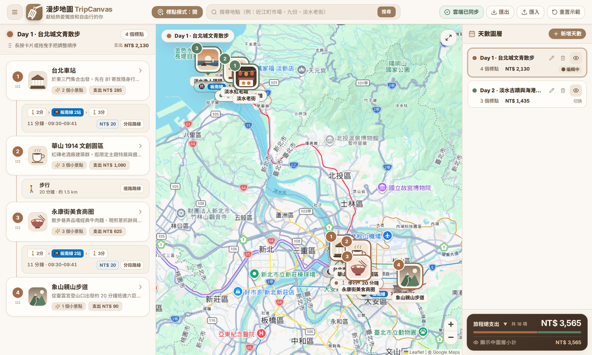
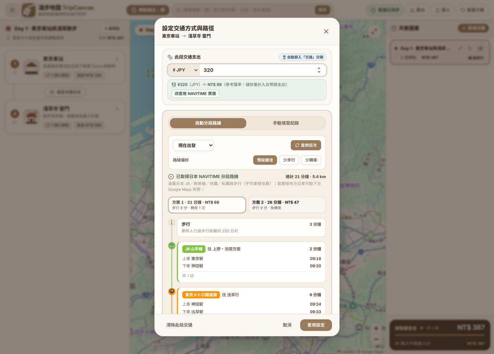
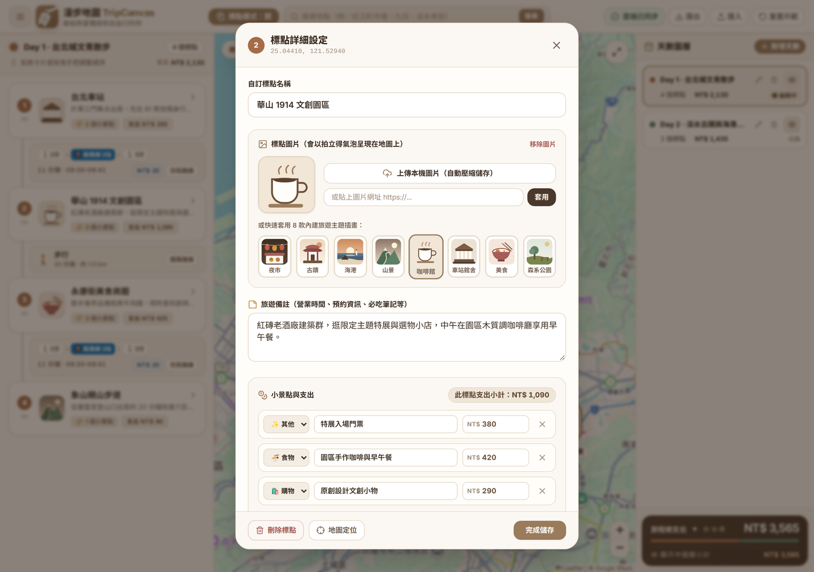
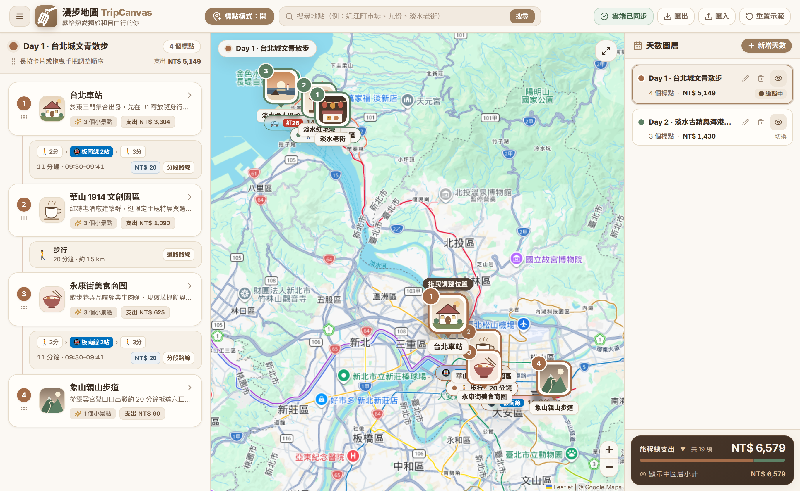
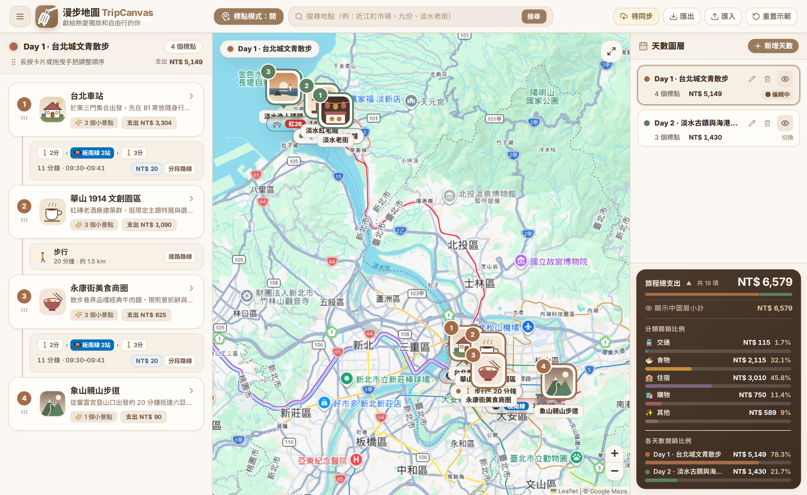

# 漫步地圖 TripCanvas

> **獻給熱愛獨旅和自由行的你**

一款專為自助旅行者打造的互動式旅遊地圖規劃網站，結合官方 Google Maps 底圖互動標點（並內建 Leaflet 備援引擎）、貼路與大眾運輸班次查詢、多國匯率即時換算、分類支出統計，以及個人 Google 雲端硬碟跨裝置同步。

🔗 **線上體驗網址**：[https://tripcanvas-ten.vercel.app](https://tripcanvas-ten.vercel.app)

---

## ✨ 產品特色

### 1. 專為獨旅與自由行熱愛者設計
採用溫潤耐看的貓頭鷹淺咖啡大地色系與繁體中文地圖介面，將「找景點、排順序、查交通、記開銷」整合在同一個清爽畫布裡。
- **電腦與橫向平板（≥ 1024px）**：全幅互動地圖搭配左右**圓角半透明毛玻璃浮動工作區塊**（可單獨收合或一鍵全螢幕地圖），總支出膠囊懸浮於地圖下方中央走廊。
- **手機與直向平板（< 1024px）**：單列置頂即時搜尋欄、不遮擋地圖的底部半透明雙圓球（行程清單／天數圖層）與中央總支出圓弧膠囊，單手就能優雅操作。



---

### 2. Google 原生底圖精準點選 × 即時搜尋通配跨語系地名
- **點畫面上看得到的點**：啟用 Google Maps JS SDK 後，直接點擊底圖上的餐廳、車站或景點圖示即可原生讀取 `placeId` 與一致的繁中／當地名稱，一鍵加入行程；空處右鍵（電腦／平板外接觸控板）或長按（手機／iPad 觸控與 Apple Pencil）也能即時設點並智慧吸附鄰近地標。
- **打字即時搜尋**：輸入關鍵字即自動彈出清單，優先排序目前旅遊計畫所在國家的景點，並支援繁體中文 ↔ 日文新字體 ↔ 簡體中文通配（如輸入「金澤」同步通配「金沢」）。

---

### 3. 點到點交通規劃：大眾運輸班次、公車號碼優先呈現與多國匯率自動結算
任意兩個景點之間都能快速設定汽車、機車、大眾運輸、自行車或步行的真實貼路路線。選擇**大眾運輸**時，支援全球 Google Routes 與日本 NAVITIME 分段路線查詢，直接呈現完整轉乘方案、官方路線代表色、發車與抵達時刻並自動帶入票價；**公車與客運路線優先顯示號碼**（如 `307`、`紅26`、`都08`、`205`，無號碼時才退回顯示路線名稱），搭車辨識更直覺。內建 **TWD、JPY、KRW、USD、EUR、HKD、SGD、THB、GBP、CNY** 等 10 種常用幣別，外幣車資即時換算為新台幣並納入總支出。



---

### 4. 自訂景點插圖、11 款內建圖標 × 小景點多幣別記帳（含住宿分類）
每一個標點皆可自由命名、撰寫營業資訊與行前筆記，並可上傳本機照片（自動壓縮）、貼上圖片網址，或一鍵套用 **11 款貓頭鷹大地色系主題插畫**（包含 **✈️ 機場、🚉 車站、🏡 民宿**），以拍立得氣泡呈現在地圖上。點開景點還能記錄多筆「小景點與支出」細項，依 **🚆 交通、🍜 食物、🏨 住宿、🛍️ 購物、✨ 其他** 五大類別統計，且**每一筆支出皆可直接選擇外幣並即時自動換算為新台幣**；誤刪景點時亦提供 5 秒內「復原」操作。



---

### 5. 地圖長按標點即可拖曳微調位置
在電腦滑鼠或手機觸控螢幕上，只要**長按地圖上的任一標點**，標點便會浮起並顯示「拖曳調整位置」光暈提示，直接拖曳至更精準的出入口或巷弄位置即可完成定位；放開後會自動更新座標、智慧刷新尚未自訂的預設名稱，並重新整理相連的交通路徑。



---

### 6. 多天數獨立圖層 × 手機版輕巧微控
- **電腦版**：右側天數圖層面板可自由增設多組色彩圖層（Day 1、Day 2…），獨立切換「眼睛」顯隱、雙擊更名；左側行程面板頂端亦內建開合動畫天數快選選單，單張卡片右側提供上下對稱的「Google Maps 導出」與「快速刪除」按鈕。
- **手機版**：點擊右下角天數圓球展開「第 N 天」正方形列，點擊任一天數立即切換圖層並在旁彈出 **👁️ 眼睛小圓**（即時開關地圖顯示）與 **⚙️ 齒輪小圓**（更名、刪除與顯隱設定），不額外彈出行程清單干擾地圖視野；行程清單本身則可由左下圓球開啟並透過頂端下拉選單自由切換天數。


---

### 7. 多旅遊計畫獨立珍藏 × 個人 Google 雲端硬碟多裝置同步
點擊左上角選單即可建立、切換、複製或管理多份彼此獨立的旅遊計畫，亦支援匯出／匯入單一計畫或完整工作區備份 JSON。除了瀏覽器內建 `localStorage + IndexedDB` 雙重本地備份，更支援登入個人 Google 帳號，將行程自動存入**使用者自己的 Google 雲端硬碟**（搭配樂觀鎖防覆寫與自動合併），零資料庫成本即可在電腦、平板與手機間無縫同步。


---

### 8. 總支出即時掌握：全裝置底部中央膠囊，一鍵查看五大分類比例
無論電腦、平板或手機，底部中央皆懸浮深咖色圓弧「總支出」膠囊，點擊即可向上展開視覺化統計卡片，一目了然檢視 **「交通／食物／住宿／購物／其他」五大分類比例** 以及各天數的開銷佔比與顯示中圖層小計。

<table>
  <tr>
    <td width="68%" align="center" valign="top">
      
      <br />
      <sub><strong>電腦／平板版</strong>：底部中央總支出膠囊點開顯示五大分類與各天比例</sub>
    </td>
    <td width="32%" align="center" valign="top">
      
      <br />
      <sub><strong>手機版</strong>：底部中央長條圓弧直接顯示總支出，點擊展開明細</sub>
    </td>
  </tr>
</table>

---

## 🛠️ 技術架構

- **前端**：Vite 6 + 原生 ES Modules（Vanilla JS）+ Tailwind CSS v3 + Google Maps JavaScript SDK（雙引擎自動按需延遲載入 Leaflet 備援）+ Lucide Icons
- **後端代理（Vercel Serverless Functions，含同源檢查、速率限制與請求逾時防護）**：
  - `/api/routes`：封裝 Google Routes API v2（高精度貼路與全球大眾運輸）、Places API (New) / Geocoding API（搜尋、反查與 `placeId` 詳情）、日本 NAVITIME RapidAPI（日本鐵路／地鐵分段路線）與即時匯率查詢；未設金鑰時陸路自動降級至免費 FOSSGIS OSRM。
  - `/api/drive` & `/api/drive-callback`：採用 Google OAuth 2.0（PKCE）與 AES-256-GCM 加密 `HttpOnly` Cookie，透過非機密權限 `drive.file` 直接讀寫使用者個人 Google 雲端硬碟中的「`漫步地圖 TripCanvas`」同步檔，並支援 `modifiedTime` 樂觀鎖衝突偵測與自動合併。

---

## 🚀 本機開發與部署

### 本機啟動
```bash
npm install
cp .env.example .env.local
# 依需求於 .env.local 填入環境變數
npm run dev
```
開啟終端機顯示的網址（預設 `http://localhost:5173`）即可使用。

> 即使尚未填入任何 API 金鑰，網站仍可完整運作：底圖會自動延遲載入免費 Leaflet 圖磚，陸路會自動使用 FOSSGIS OSRM 貼路引擎，行程會自動透過 `localStorage + IndexedDB` 雙重保存於本機瀏覽器。

### 部署至 Vercel（環境變數一覽）
將專案匯入 Vercel（框架選 **Vite**）後，可依需求至 **Settings → Environment Variables** 設定：

| 環境變數 | 必填 | 用途說明 |
| :--- | :---: | :--- |
| `GOOGLE_MAPS_API_KEY` | 選填 | 伺服器端專用金鑰：啟用 Google Routes API v2、Places API (New) 與 Geocoding API（應用程式限制請選「無」，改設每日配額保護費用） |
| `GOOGLE_MAPS_JS_API_KEY` | 選填 | 瀏覽器專用金鑰：啟用 Google Maps JavaScript API 官方互動底圖（建議設定 HTTP 網域限制，如 `https://<你的網域>/*`） |
| `RAPIDAPI_NAVITIME_KEY` | 選填 | 啟用日本大眾運輸自動分段查詢與日圓票價換算（RapidAPI NAVITIME Route(totalnavi) 免費 Basic 方案即可） |
| `GOOGLE_OAUTH_CLIENT_ID` | 選填 | 啟用使用者個人 Google 雲端硬碟跨裝置同步（搭配 Google Drive API 與非機密權限 `drive.file`） |
| `GOOGLE_OAUTH_CLIENT_SECRET` | 選填 | 同上，OAuth 2.0 網頁應用程式用戶端密鑰；已授權重新導向 URI 需填入 `https://<你的網域>/api/drive-callback` |
| `SESSION_SECRET` | 選填 | 建議正式環境設定的獨立 Cookie 加密主密鑰（32 字元以上隨機字串，未設時自動由 OAuth Secret 衍生） |
| `GOOGLE_OAUTH_REDIRECT_URI` | 選填 | 明確鎖定 OAuth Callback 網址（未設時自動依請求網域推導） |

---

## 🧪 測試與建置指令

```bash
npm test       # 執行安全防護、路線代理、匯率換算、狀態消毒、多計畫管理與 Google Drive 同步單元測試
npm run build  # 產出正式環境建置檔
```
