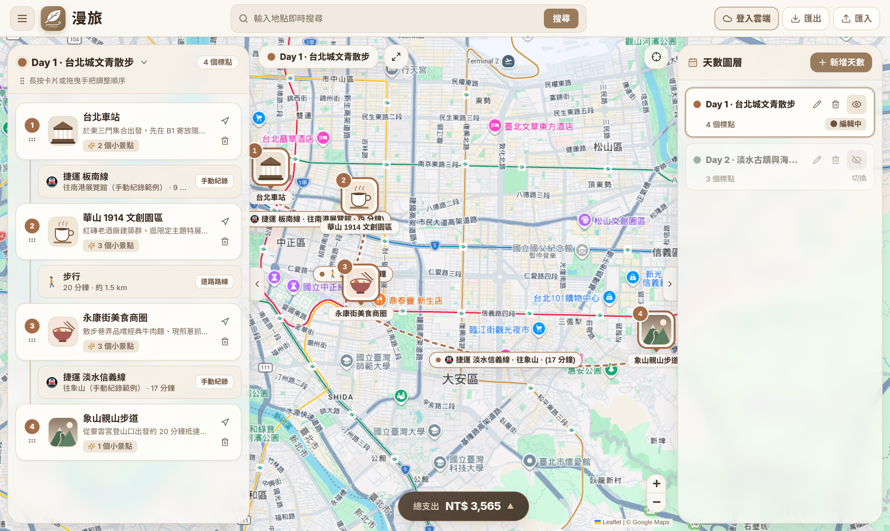
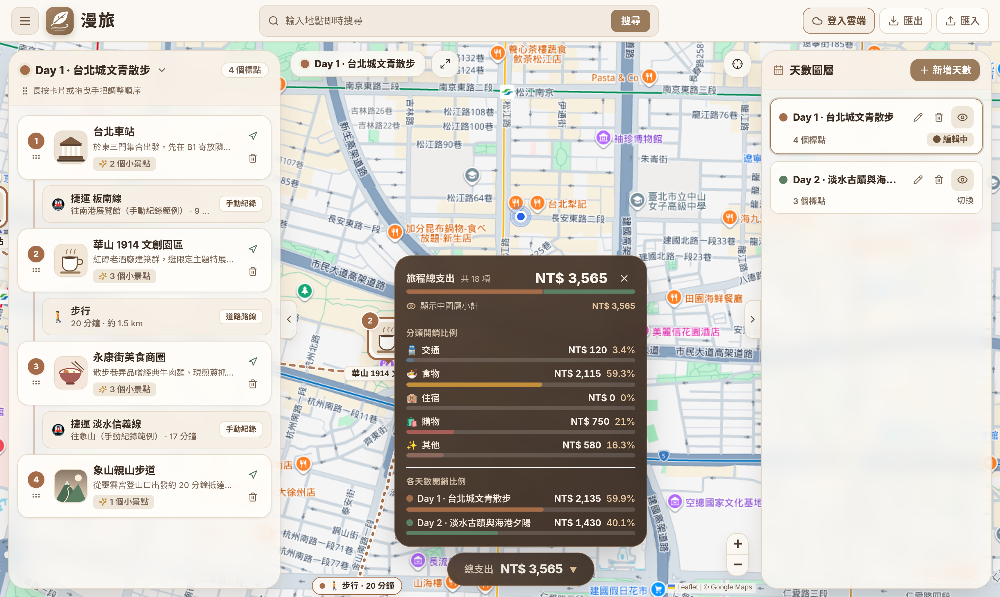
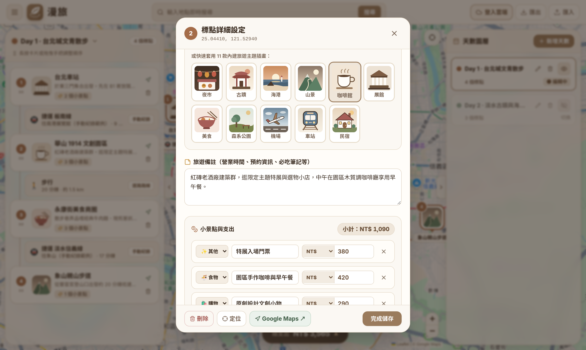
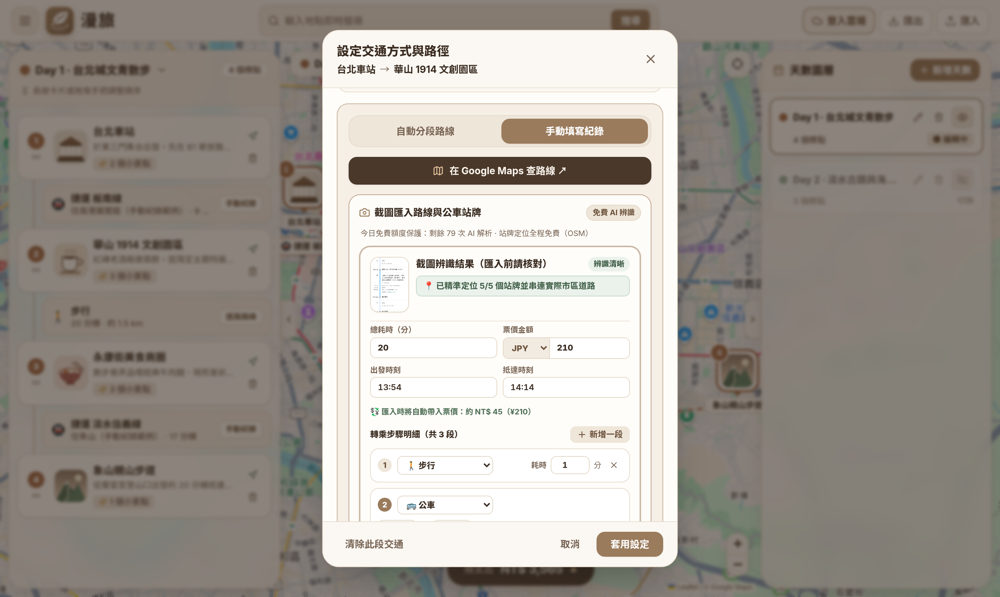
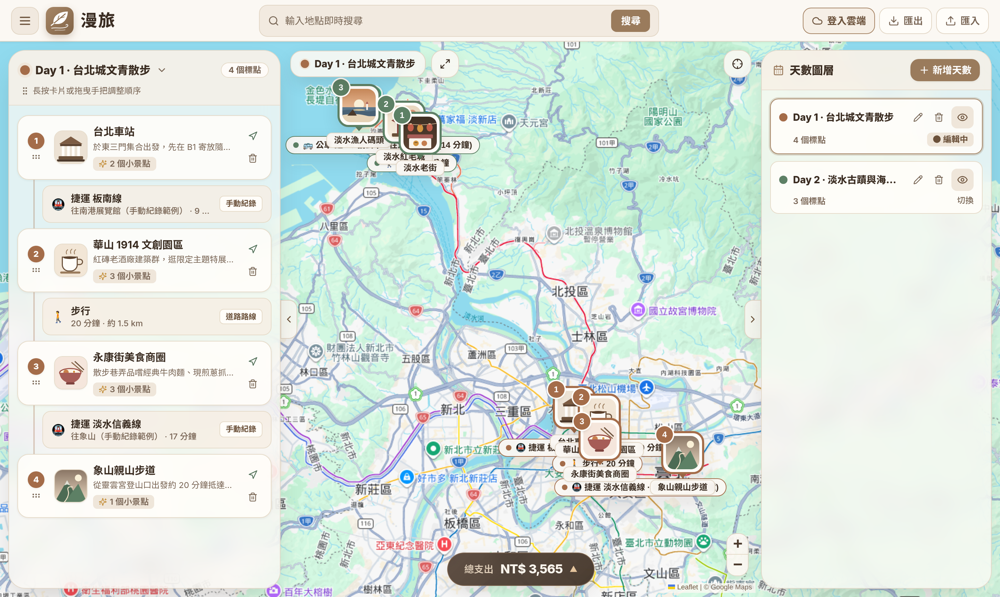
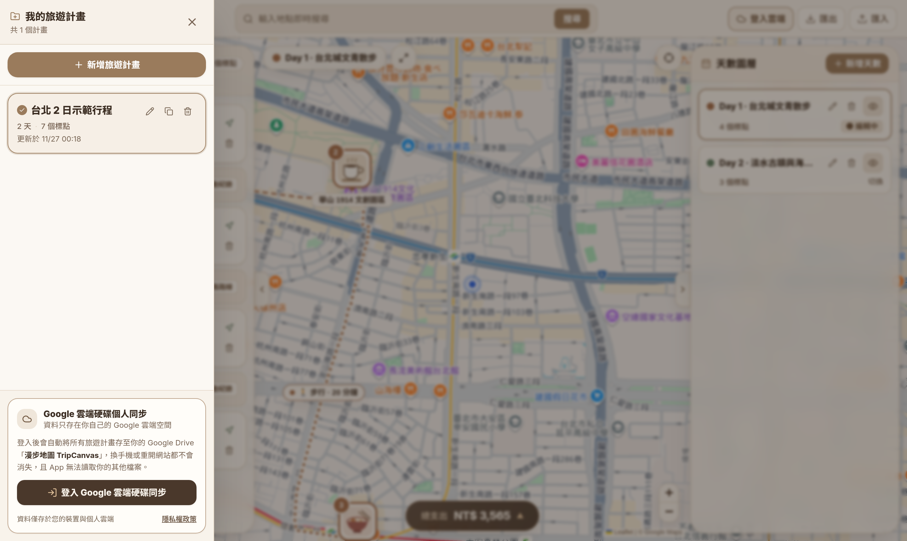
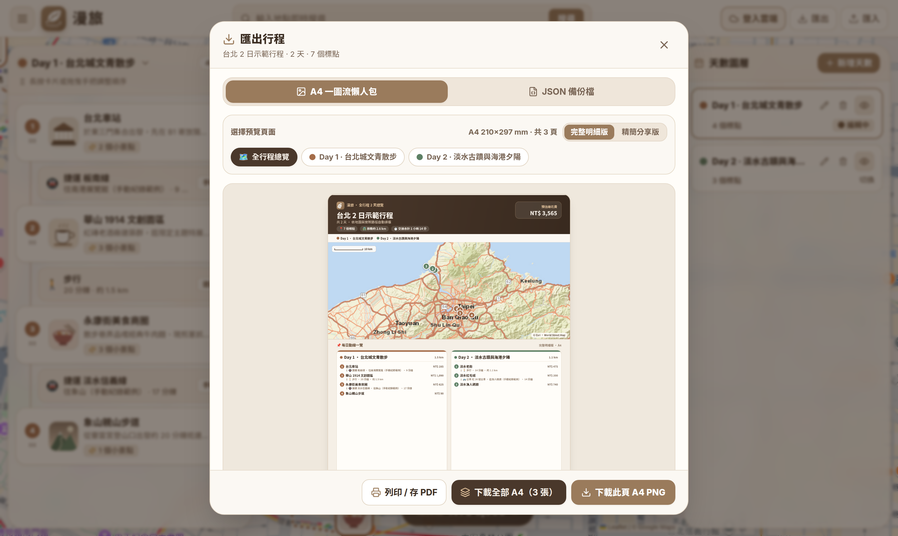
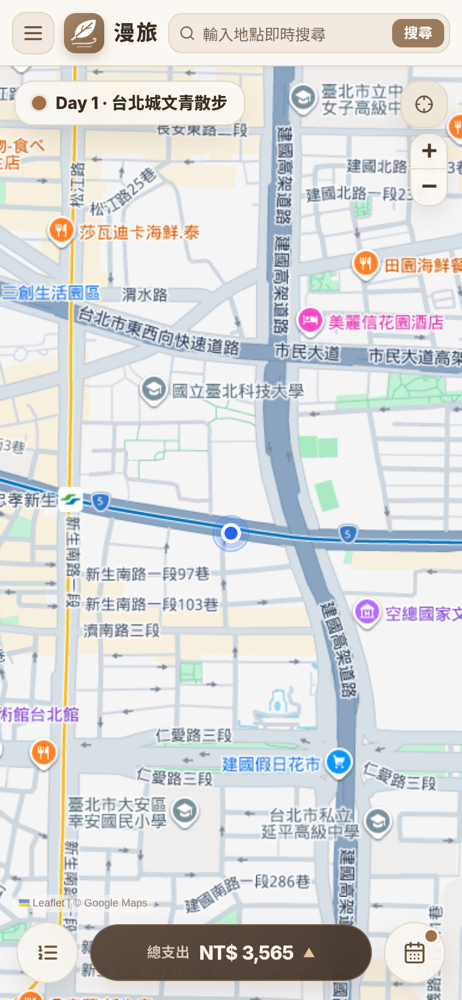

<p align="center">
  
</p>

<h1 align="center">漫旅</h1>

<p align="center">
  一款專為自由行與獨旅打造的互動式地圖行程規劃工具。<br />
  在同一張地圖上完成景點標註、路線安排、多幣別記帳、天數圖層切換、跨裝置雲端同步，並一鍵產出 A4 行程一圖流。
</p>

<p align="center">
  <a href="https://tripcanvas-ten.vercel.app"><strong>🌐 立即開啟漫旅（線上版）</strong></a>
  &nbsp;·&nbsp;
  <a href="CHANGELOG.md"><strong>📋 更新日誌（CHANGELOG）</strong></a>
</p>



---

## 🗺️ 介面分區與功能導覽

### 1. 中央地圖主視窗：直覺標點、定位與總支出總覽

所有旅遊規劃都圍繞中央互動地圖展開，支援 Google Maps 底圖與開放地圖雙引擎：

- **快速新增標點**：
  - **電腦版**：於地圖任意位置**點擊右鍵**即可新增標點。
  - **手機／平板**：於地圖任意位置**長按**即可新增標點。
  - 也可透過頂部搜尋欄即時搜尋地點加入，或直接點選地圖上的地標圖示一鍵加入行程。
- **長按拖曳調整位置**：在地圖上**長按任一標點**浮起後即可拖曳微調精準座標（例如改拉到車站出口或巷弄入口），放開後相連的交通路徑也會同步更新。
- **左上角全螢幕按鈕（`⤢`）**：一鍵將左右兩側模組全部收起，享有最大視野的全螢幕地圖（兩側亦各有獨立收合箭頭）。
- **右上角定位按鈕（狙擊鏡圖示）**：使用裝置原生 GPS **定位自己目前所在位置**（顯示藍點與精度範圍圈），旅遊途中想臨時在附近新增景點或確認方位特別方便。
- **底部「總支出」統計膠囊**：點擊地圖下方中央深咖色膠囊即可向上展開支出統計面板，清楚查看整趟旅程與各天數的花費總額，以及 **交通／食物／住宿／購物／其他** 五大支出種類的比例分佈。



---

### 2. 左側模組：標點管理、多國貨幣記帳與交通路線

左側面板集中管理當天所有景點與路段，由上而下對應實際移動順序：

#### 📍 標點管理與詳情設定
- **自由調整順序**：**長按卡片或拖曳左側手把**即可上下移動景點順序，地圖編號與路線會即時重算。
- **完整景點內容**：點擊任一標點進入編輯視窗，可自訂：
  - **圖片與圖示**：上傳相簿照片、貼上圖片網址，或選用 11 款內建暖色系旅遊圖標（含機場、車站、民宿等）。
  - **名稱與備註**：自由修改景點名稱、記錄營業時間、必點清單或行前提醒。
  - **細項支出＋多國貨幣即時換算**：可在單一景點內新增多筆消費細項並分類，支援 **TWD、JPY、KRW、USD、EUR、HKD、SGD、THB、GBP、CNY** 等多國幣別輸入，即時換算為新台幣並自動計入總支出。



#### 🚌 標點間交通方式與大眾運輸截圖匯入
點擊相鄰兩個標點之間的連接處，即可設定 **🚗 汽車、🛵 機車、🚲 自行車、🚆 大眾運輸、🚶 步行** 五種移動方式，系統會自動計算耗時並在地圖上繪製貼路軌跡。

- **大眾運輸班次直接選擇**：可直接查詢並選取大眾運輸轉乘方案、出發／抵達時間與車資。
- **日本大眾運輸與公車使用說明**：
  - 受限於日本各地方公車業者的資料授權與 Google Maps 限制，目前日本地區僅 **新幹線、JR、私鐵、機場公車** 可直接於站內選取班次。
  - **日本市區公車請用「截圖匯入」**：於大眾運輸視窗跳轉至 Google Maps 查好公車路線後，直接將**左側路線步驟資訊**（或平板含右側地圖站牌的畫面）**截圖上傳或貼上匯入**即可自動建立公車路線。
  - > 💡 **發揮最佳定位效果的小技巧**：截圖時請記得將**「中途經過的停靠站」點開展開**，並**一併截到票價金額**！系統會自動解析公車路線、站數、起迄時刻與票價，並從沿途站點均勻抽取最多 5 個前／中／後關鍵站牌做免費站牌定位，在地圖上畫出最貼合實際繞行路徑的公車線，匯入前也能在核對卡片中自由微調。



---

### 3. 右側模組：天數圖層自由切換

右側面板專責管理整趟旅程的天數結構：

- 自由新增、雙擊改名或刪除天數（Day 1、Day 2…），每一天皆配置專屬色系。
- 點擊各天右側的 **眼睛圖示（👁️）**，可彈性決定要**單獨呈現某一天的景點與動線**，或是**同時開啟多天圖層疊加檢視**，快速檢視跨日行程的地理分佈是否順路。



---

### 4. 最左上角選單（三條線）：多旅遊計畫與雲端多機共同編輯

點擊頁面最左上角的 **三條橫線選單按鈕（☰）**：

- **獨立管理多個旅遊計畫**：可隨時制定全新旅遊計畫、切換不同旅程，或複製既有計畫進行微調，彼此資料獨立不互蓋。
- **Google 雲端硬碟備份與多機共同編輯**：登入個人 Google 帳號開啟雲端備份後，行程資料會安全存放在使用者自己的 Google 雲端硬碟專屬資料夾中（本服務不存取雲端內其他任何檔案），備份防遺失之餘，也能在**電腦、平板、手機多台裝置間同步與共同編輯**同一份行程。



---

### 5. 頂部匯出／匯入：分享行程檔 ＆ A4 一圖流懶人包

點擊頂部右側（或手機抽屜內）的 **匯出 / 匯入** 工具：

- **匯出／匯入地圖檔（JSON）**：將整份旅遊計畫匯出成 JSON 檔案傳給親朋好友；對方開啟「漫旅」並點選「匯入」，即可完整載入所有景點、備註、交通與花費，直接在地圖上查看或接著調整。
- **生成 A4 懶人包一圖流**：免手動排版，一鍵將單日或全行程自動輸出為統一 **標準 A4 尺寸**的精美圖片（PNG）或可列印多頁 PDF，包含真實地圖路線、景點順序、交通轉乘資訊與預算摘要，旅遊途中隨時開圖或列印隨身攜帶都一目了然。



---

### 6. 手機與平板行動體驗

行動裝置介面針對單手操作重新調整：頂部保留精簡「漫旅」標誌與即時搜尋欄，右上角同樣提供一鍵定位自己位置，底部以不遮擋地圖的半透明雙圓球（行程清單／天數圖層）與中央總支出膠囊呈現，隨時邊走邊查、長按地圖即刻加點。

<p align="center">
  
</p>

---

## 🚀 本機開發與部署參考

```bash
npm install
cp .env.example .env.local
npm run dev      # 啟動本機開發伺服器
npm test         # 執行單元測試
npm run build    # 建置正式版靜態檔案
```

> 即使未設定任何 API 金鑰，網站仍可使用免費開源底圖（Leaflet）、免費貼路路徑（OSRM）、免費站牌定位（Photon / OSM）與本機瀏覽器雙重備份（`localStorage + IndexedDB`）。

部署至 Vercel（框架選擇 **Vite**）時，可依需求設定以下選填環境變數：

| 環境變數 | 用途說明 |
| :--- | :--- |
| `GOOGLE_MAPS_JS_API_KEY` | 啟用官方 Google Maps 互動底圖與點選地標詳情 |
| `GOOGLE_MAPS_API_KEY` | 啟用 Google Routes API 貼路規劃、Places 搜尋與 Geocoding |
| `RAPIDAPI_NAVITIME_KEY` | 啟用日本新幹線／JR／私鐵／機場公車班次自動查詢 |
| `GEMINI_API_KEY` | 啟用 Google AI Studio 免費層公車截圖視覺辨識（站牌定位全程免費 OSM） |
| `GOOGLE_OAUTH_CLIENT_ID` / `GOOGLE_OAUTH_CLIENT_SECRET` | 啟用 Google 雲端硬碟個人備份與多機共同編輯 |
| `SESSION_SECRET` | 正式環境 Cookie 加密主密鑰（建議 32 字元以上隨機字串） |

---

## 📋 更新日誌

所有版本演進、新功能與細節優化皆收錄於 **[CHANGELOG.md](CHANGELOG.md)**。
