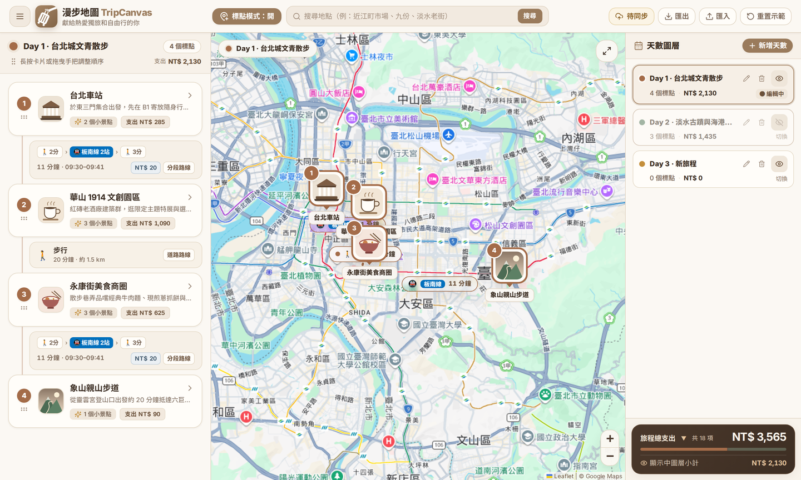
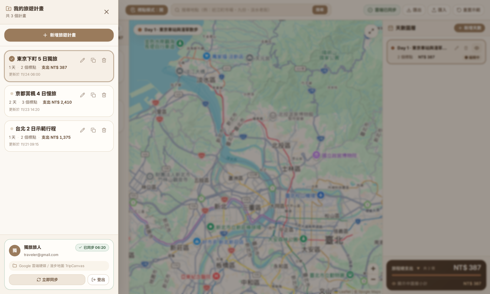
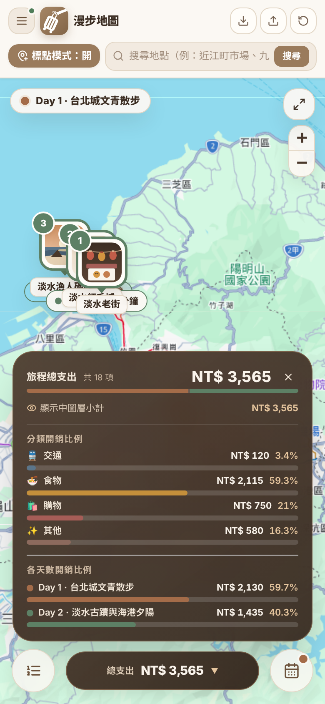

# 漫步地圖 TripCanvas

> **獻給熱愛獨旅和自由行的你**

一款專為自助旅行者打造的互動式旅遊地圖規劃網站，結合直覺的地圖標點、貼路與大眾運輸班次查詢、多國匯率即時換算、分類支出統計，以及個人 Google 雲端硬碟跨裝置同步。

🔗 **線上體驗網址**：[https://tripcanvas-ten.vercel.app](https://tripcanvas-ten.vercel.app)

---

## ✨ 產品特色

### 1. 專為獨旅與自由行熱愛者設計
採用溫潤耐看的貓頭鷹淺咖啡大地色系與繁體中文地圖介面，將「找景點、排順序、查交通、記開銷」整合在同一個清爽畫布裡。電腦與平板提供三欄式全景規劃視野；手機版則搭配不遮擋地圖的半透明浮動雙圓球與手勢互動，旅途中也能單手優雅操作。


---

### 2. 點到點交通規劃：大眾運輸即時方案、班次與多國匯率自動結算
任意兩個景點之間都能快速設定汽車、機車、大眾運輸、自行車或步行的真實貼路路線。選擇**大眾運輸**時，支援全球 Google Routes 與日本 NAVITIME 分段路線查詢，直接呈現完整轉乘方案、路線代表色、發車與抵達時刻並自動帶入交通票價；內建 **TWD、JPY、KRW、USD、EUR、HKD、THB、SGD、GBP、CNY** 等 10 種常用幣別，外幣車資即時換算為新台幣並納入總支出。


---

### 3. 自訂景點名稱與拍立得插圖，支援小景點細項與分類記帳
每一個標點皆可自由命名、撰寫營業資訊與行前筆記，並可上傳本機照片（自動壓縮）、貼上圖片網址，或一鍵套用 8 款手繪風旅遊插畫，以拍立得氣泡呈現在地圖上。點開景點還能細分多筆「小景點」項目，依 **🍜 食物、🚆 交通、🛍️ 購物、✨ 其他** 四大類別記錄花費，讓旅程細節與花費清清楚楚。


---

### 4. 多天數獨立圖層，自由開關呈現讓規劃更專注
一趟旅行可依行程天數自由增設多組色彩圖層（Day 1、Day 2、Day 3…），並透過右側「眼睛」按鈕獨立切換各天數在地圖上的顯示或隱藏狀態。規劃跨區長途旅程時，可隨時聚焦檢視單日動線，畫面依然俐落不凌亂。



---

### 5. 多旅遊計畫獨立珍藏 × 個人 Google 雲端硬碟多裝置同步
點擊左上角選單即可建立、切換、複製或管理多份彼此獨立的旅遊計畫——開啟下一趟旅程不必覆蓋先前的安排，完整保留每一段自由行回憶。除了瀏覽器內建 `localStorage + IndexedDB` 雙重本地備份，更支援登入個人 Google 帳號，將行程自動存入**使用者自己的 Google 雲端硬碟**，零資料庫成本即可在電腦、平板與手機間無縫備份與接續編輯。



---

### 6. 總支出即時掌握：電腦版右下角 × 手機版底部中央，一鍵查看開銷比例
無論在哪種裝置上都能隨時掌握旅費分配——電腦與平板版於右下角呈現深咖總支出卡片，手機版則以長條圓弧膠囊懸浮於畫面底部正中央。點擊即可展開視覺化統計條，一目了然檢視「交通／食物／購物／其他」四大分類比例以及各天數的開銷佔比。

<table>
  <tr>
    <td width="68%" align="center" valign="top">
      
      <br />
      <sub><strong>電腦／平板版</strong>：右下角總支出卡片點開顯示分類與各天比例</sub>
    </td>
    <td width="32%" align="center" valign="top">
      
      <br />
      <sub><strong>手機版</strong>：底部中央長條圓弧直接顯示總支出，點擊展開明細</sub>
    </td>
  </tr>
</table>

---

## 🛠️ 技術架構

- **前端**：Vite 6 + 原生 ES Modules（Vanilla JS）+ Tailwind CSS v3 + Leaflet + Lucide Icons
- **後端代理（Vercel Serverless Functions）**：
  - `/api/routes`：封裝 Google Routes API v2（高精度貼路與全球大眾運輸）、日本 NAVITIME RapidAPI（日本鐵路／地鐵分段路線）與即時匯率查詢，未設金鑰時陸路自動降級至免費 FOSSGIS OSRM。
  - `/api/drive` & `/api/drive-callback`：採用 Google OAuth 2.0（PKCE）與 AES-256-GCM 加密 `HttpOnly` Cookie，透過非機密權限 `drive.file` 直接讀寫使用者個人 Google 雲端硬碟中的「`漫步地圖 TripCanvas`」同步檔，無需額外資料庫。

---

## 🚀 本機開發與部署

### 本機啟動
```bash
npm install
cp .env.example .env.local
# 依需求於 .env.local 填入環境變數
npm run dev
```
開啟終端機顯示的網址（預設 `http://localhost:5173`）即可使用。

> 即使尚未填入任何 API 金鑰，網站仍可完整運作：陸路會自動使用免費 FOSSGIS OSRM 貼路引擎，行程會自動透過 `localStorage + IndexedDB` 雙重保存於本機瀏覽器。

### 部署至 Vercel（環境變數一覽）
將專案匯入 Vercel（框架選 **Vite**）後，可依需求至 **Settings → Environment Variables** 設定：

| 環境變數 | 必填 | 用途說明 |
| :--- | :---: | :--- |
| `GOOGLE_MAPS_API_KEY` | 選填 | 啟用 Google Routes API v2 高精度陸路與全球大眾運輸分段查詢（API 限制僅勾選 `Routes API`，應用程式限制請選「無」） |
| `RAPIDAPI_NAVITIME_KEY` | 選填 | 啟用日本大眾運輸自動分段查詢與日圓票價換算（RapidAPI NAVITIME Route(totalnavi) 免費 Basic 方案即可） |
| `GOOGLE_OAUTH_CLIENT_ID` | 選填 | 啟用使用者個人 Google 雲端硬碟跨裝置同步（搭配 Google Drive API 與非機密權限 `drive.file`） |
| `GOOGLE_OAUTH_CLIENT_SECRET` | 選填 | 同上，OAuth 2.0 網頁應用程式用戶端密鑰；已授權重新導向 URI 需填入 `https://<你的網域>/api/drive-callback` |

---

## 🧪 測試與建置指令

```bash
npm test       # 執行路線代理、匯率換算、多計畫管理與 Google Drive 同步單元測試
npm run build  # 產出正式環境建置檔
```
